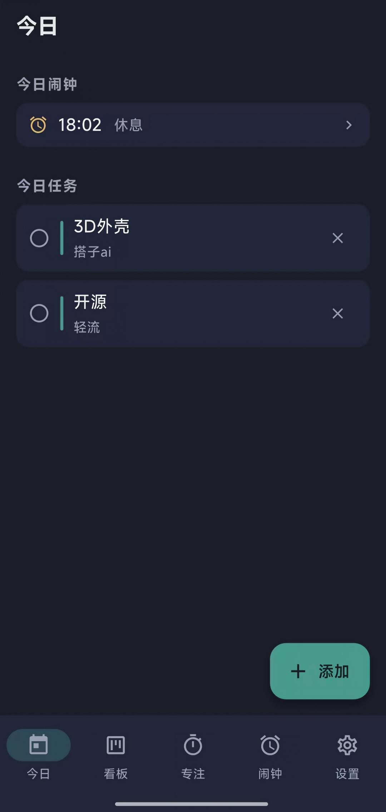
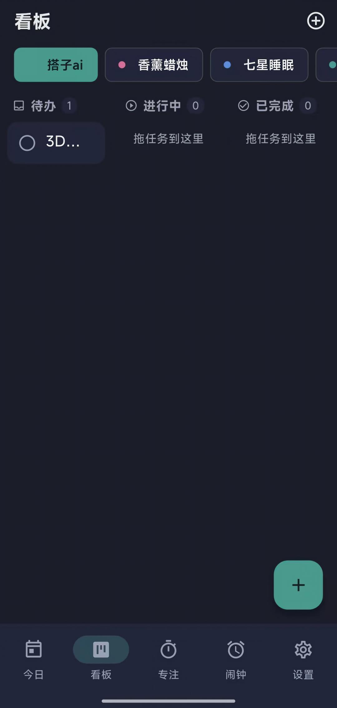
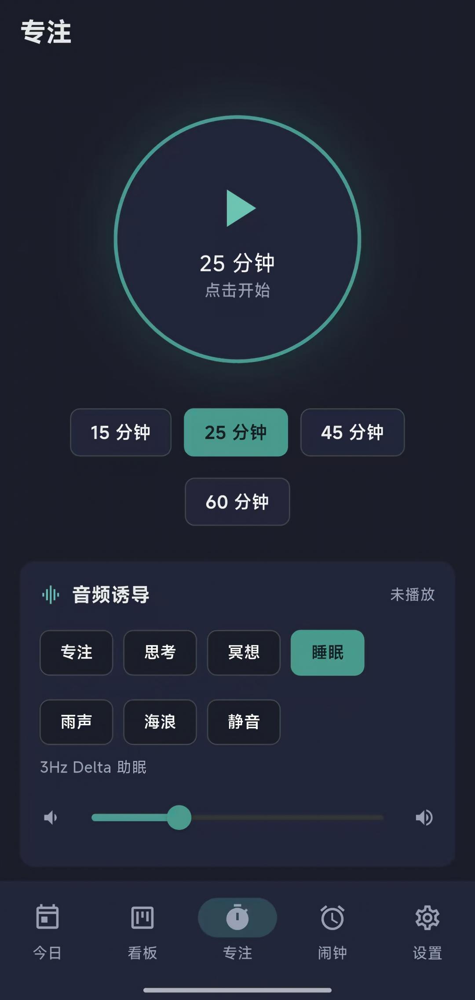
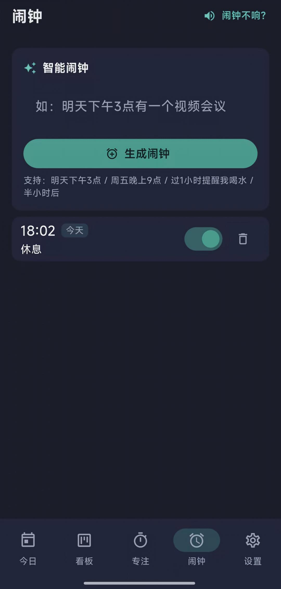
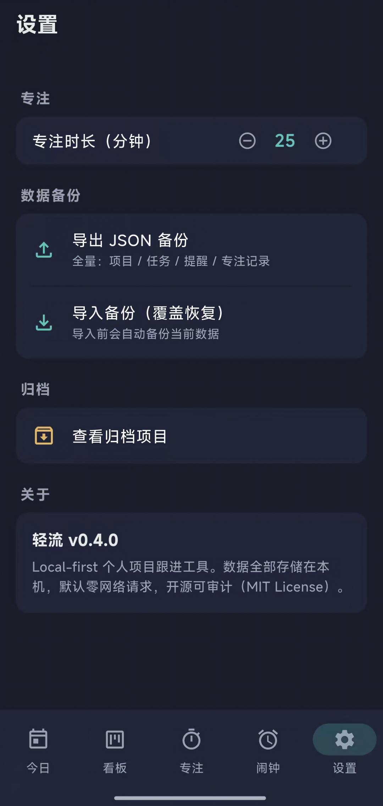

# 轻流（qingliu）

轻流 - 个人项目跟进 App（看板 + 提醒 + 番茄专注）。

一款面向个人的 Android 离线应用：用看板管理项目任务，用智能闹钟与任务提醒安排日程，用纯计时专注页配合双耳节拍 / 环境音保持专注。全程零网络依赖，数据本地存储，支持备份导出 / 导入。

## 功能特性

- **今日页**：显式勾选加入今日的任务集合，支持不关联项目的临时任务；展示今日闹钟分区
- **看板页**：项目横向切换、三列（待办 / 进行中 / 已完成）长按拖拽、中值排序；长按项目可编辑 / 归档 / 删除
- **专注页**：纯倒计时（15 / 25 / 45 / 60 分钟快捷选择），无任务关联
- **音频诱导**：纯代码合成 WAV，无音频资源
  - 双耳节拍预设：专注（432/444Hz）、思考（332/356Hz）、冥想（180/188Hz）、睡眠（140/143Hz），带浪涌音量包络
  - 环境音：雨声、海浪
- **闹钟页**：自然语言创建闹钟（本地中文时间解析，零网络），如「明天下午3点有一个视频会议」「过1小时提醒我喝水」；支持全屏响铃、响到关闭
- **设置页**：专注时长、数据导出 / 导入（分享或保存本地）、归档项目管理

## 技术栈

| 类别      | 选型                                                        |
| ------- | --------------------------------------------------------- |
| 框架      | Flutter（Dart 3.13+）                                       |
| 状态管理    | flutter_riverpod                                          |
| 数据库     | drift（SQLite）                                             |
| 通知 / 闹钟 | flutter_local_notifications + timezone + flutter_timezone |
| 音频      | audio_service + just_audio（WAV 运行时合成）                     |
| 备份      | json_serializable + file_picker + share_plus              |

## 项目结构

```
.
├── app/                        # Flutter 应用主体
│   ├── lib/
│   │   ├── data/               # drift 数据库与仓库层
│   │   ├── services/           # 番茄引擎、音频合成、通知、NLP 时间解析等
│   │   ├── providers.dart      # Riverpod providers
│   │   ├── pages/              # 今日 / 看板 / 专注 / 闹钟 / 设置 / 引导页
│   │   └── widgets/            # 任务卡、编辑弹层、响铃页等
│   ├── test/                   # 单元测试（引擎、解析器、备份、音频合成）
│   └── android/                # Android 平台配置（闹铃资源、权限、MethodChannel）
├── docs/                       # 需求开发文档（v0.1 ~ v0.5 迭代记录）
└── .flutter_version.txt
```

## 环境要求

- Flutter 3.47.1 / Dart 3.13.1（本项目使用 `C:\greensoft\flutter`）
- Android SDK / JDK（AGP 构建）
- 中文路径不兼容 AGP / CMake / AOT，见下方构建说明

## 构建与运行

> 

```powershell
flutter pub get
flutter run
```

数据库 schema 变更后需重新生成 drift 代码：

```powershell
dart run build_runner build --force-jit
```

静态检查与测试：

```powershell
dart analyze        # flutter analyze 的 LSP 在中文路径下崩溃，用 dart analyze
flutter test
```

Release 构建：

```powershell
flutter build apk --release --split-per-abi
# 产物：build\app\outputs\flutter-apk\app-arm64-v8a-release.apk（约 11MB）
```

注意：**不要开启 R8 minify**（path_provider 2.3.1 走 JNI，R8 有剥离风险）。

## 软件截图

|  |  |  |
| -------------------- | -------------------- | -------------------- |
|  |  |                      |

## 感悟

作为一个OPC（个人创业者），手上几个项目，每天总有需要干的几件事情，还有临时加入的事情。靠自己的记忆力，总会有忘记时，而且事情有轻重缓急。

一直想找一个轻量的项目管理器和智能闹钟，市面上的app要不太重，要不功能太零散，不好用。

我不会写手机程序，但现在ai编程很强，于是尝试让ai理解我的需求，做了这么一个app。经过几次迭代，现在成了我的高频使用软件。每天要干什么一清二楚，不用总牵挂着有什么事没干。工作时，戴上耳机，打开专注，确实能提高效率。

代码是ai写的，不保证没有bug或漏洞。没准备上架商店，只是开源出来，MIT协议，有需要的拿去用。

Flutter环境开发的，理论上安卓和苹果都能用。苹果没测试过，苹果的权限会更多限制，使用苹果的朋友可以编译后试试，有问题可以反馈给我。安卓机使用是没问题。


轻流 - 个人项目跟进 App（看板 + 提醒 + 番茄专注）。

一款面向个人的 Android 离线应用：用看板管理项目任务，用智能闹钟与任务提醒安排日程，用纯计时专注页配合双耳节拍 / 环境音保持专注。全程零网络依赖，数据本地存储，支持备份导出 / 导入。

## 功能特性

- **今日页**：显式勾选加入今日的任务集合，支持不关联项目的临时任务；展示今日闹钟分区
- **看板页**：项目横向切换、三列（待办 / 进行中 / 已完成）长按拖拽、中值排序；长按项目可编辑 / 归档 / 删除
- **专注页**：纯倒计时（15 / 25 / 45 / 60 分钟快捷选择），无任务关联
- **音频诱导**：纯代码合成 WAV，无音频资源
  - 双耳节拍预设：专注（432/444Hz）、思考（332/356Hz）、冥想（180/188Hz）、睡眠（140/143Hz），带浪涌音量包络
  - 环境音：雨声、海浪
- **闹钟页**：自然语言创建闹钟（本地中文时间解析，零网络），如「明天下午3点有一个视频会议」「过1小时提醒我喝水」；支持全屏响铃、响到关闭
- **设置页**：专注时长、数据导出 / 导入（分享或保存本地）、归档项目管理

## 技术栈

| 类别      | 选型                                                        |
| ------- | --------------------------------------------------------- |
| 框架      | Flutter（Dart 3.13+）                                       |
| 状态管理    | flutter_riverpod                                          |
| 数据库     | drift（SQLite）                                             |
| 通知 / 闹钟 | flutter_local_notifications + timezone + flutter_timezone |
| 音频      | audio_service + just_audio（WAV 运行时合成）                     |
| 备份      | json_serializable + file_picker + share_plus              |

## 项目结构

```
.
├── app/                        # Flutter 应用主体
│   ├── lib/
│   │   ├── data/               # drift 数据库与仓库层
│   │   ├── services/           # 番茄引擎、音频合成、通知、NLP 时间解析等
│   │   ├── providers.dart      # Riverpod providers
│   │   ├── pages/              # 今日 / 看板 / 专注 / 闹钟 / 设置 / 引导页
│   │   └── widgets/            # 任务卡、编辑弹层、响铃页等
│   ├── test/                   # 单元测试（引擎、解析器、备份、音频合成）
│   └── android/                # Android 平台配置（闹铃资源、权限、MethodChannel）
├── docs/                       # 需求开发文档（v0.1 ~ v0.5 迭代记录）
└── .flutter_version.txt
```

## 环境要求

- Flutter 3.47.1 / Dart 3.13.1（本项目使用 `C:\greensoft\flutter`）
- Android SDK / JDK（AGP 构建）
- 中文路径不兼容 AGP / CMake / AOT，见下方构建说明

## 构建与运行

> 

```powershell
flutter pub get
flutter run
```

数据库 schema 变更后需重新生成 drift 代码：

```powershell
dart run build_runner build --force-jit
```

静态检查与测试：

```powershell
dart analyze        # flutter analyze 的 LSP 在中文路径下崩溃，用 dart analyze
flutter test
```

Release 构建：

```powershell
flutter build apk --release --split-per-abi
# 产物：build\app\outputs\flutter-apk\app-arm64-v8a-release.apk（约 11MB）
```

注意：**不要开启 R8 minify**（path_provider 2.3.1 走 JNI，R8 有剥离风险）。

## 软件截图


|  |  |  |
| ----------------------------------------------- | ----------------------------------------------- | ----------------------------------------------- |
|  |  |                                                 |

## 感悟

作为一个OPC（个人创业者），手上几个项目，每天总有需要干的几件事情，还有临时加入的事情。靠自己的记忆力，总会有忘记时，而且事情有轻重缓急。

一直想找一个轻量的项目管理器和智能闹钟，市面上的app要不太重，要不功能太零散，不好用。

我不会写手机程序，但现在ai编程很强，于是尝试让ai理解我的需求，做了这么一个app。经过几次迭代，现在成了我的高频使用软件。每天要干什么一清二楚，不用总牵挂着有什么事没干。工作时，戴上耳机，打开专注，确实能提高效率。

代码是ai写的，不保证没有bug或漏洞。没准备上架商店，只是开源出来，MIT协议，有需要的拿去用。

Flutter环境开发的，理论上安卓和苹果都能用。苹果没测试过，苹果的权限会更多限制，使用苹果的朋友可以编译后试试，有问题可以反馈给我。安卓机使用是没问题。


